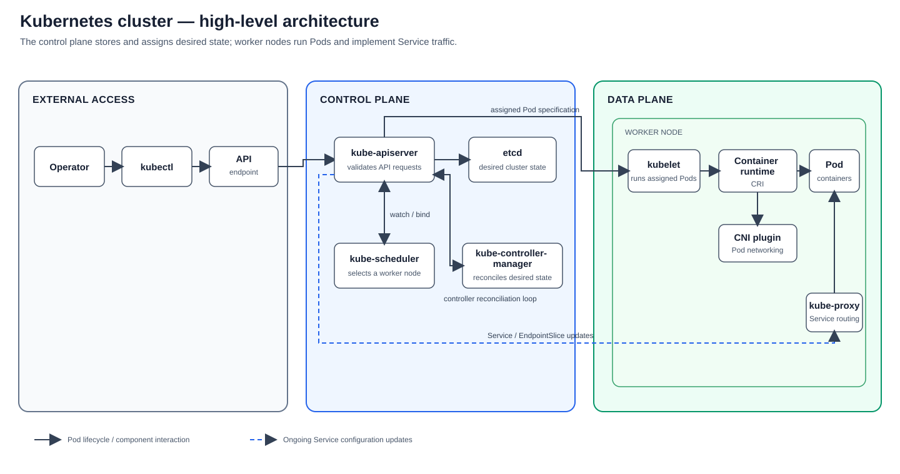
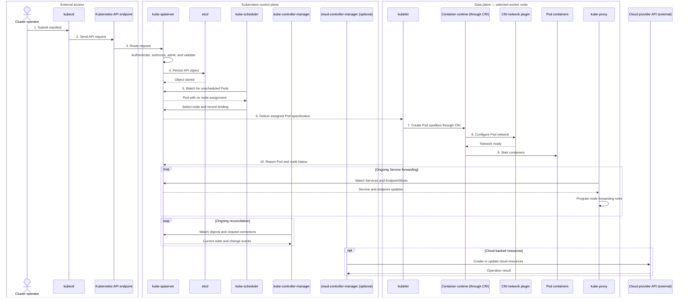
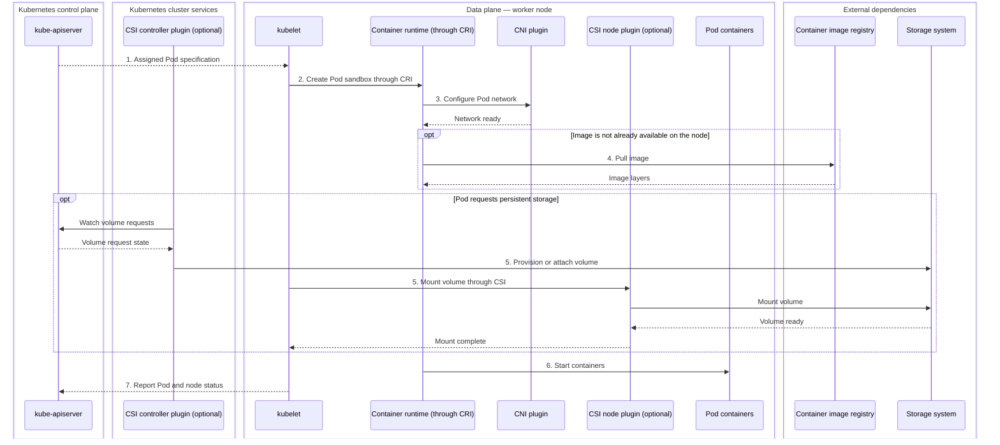
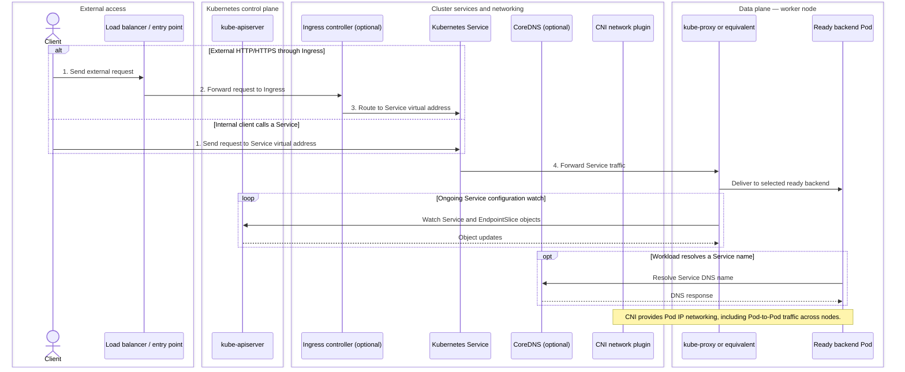

# Kubernetes Cluster Architecture

This guide shows how the Kubernetes **control plane** coordinates the **data plane**, what each component does, and common ways to combine the components when building a cluster.

The control plane stores and reconciles the desired cluster state. The data plane is made up of the machines and node services that run Pods and carry application traffic. These are architectural roles: in a small cluster, a machine can serve both roles.

## Architecture diagram

The high-level architecture map uses explicit right-angle paths and boxes to show component boundaries. The sequence diagrams below use fixed component lanes with straight horizontal messages and vertical lifelines. Numbered messages match the sequence notes below them; unnumbered messages show ongoing coordination, optional integrations, or supporting paths.

### High-level architecture

The solid arrows show the request, Pod assignment, and Pod startup paths. The dashed arrow shows ongoing Service and EndpointSlice updates to `kube-proxy`. The boxes mark the external access, control-plane, and worker-node boundaries. `kube-proxy` programs Service forwarding; kubelet and the container runtime create Pods.

## Component responsibilities

| Plane or layer | Component | Responsibility |
| --- | --- | --- |
| Client | `kubectl` | Sends commands and resource definitions to the Kubernetes API. It runs on an operator's machine and is not a cluster component. |
| Control plane | `kube-apiserver` | Exposes the Kubernetes API. It authenticates and authorizes requests, applies admission and validation, and serves reads and writes for cluster objects. Other components use the API server to coordinate. |
| Control plane | `etcd` | Persistent, consistent key-value store for Kubernetes API objects, including desired specifications and reported status. In self-managed clusters the API server uses etcd as its backing store. |
| Control plane | `kube-scheduler` | Watches for Pods without a node assignment, selects a suitable node using resource requests and scheduling constraints, then records the binding through the API. |
| Control plane | `kube-controller-manager` | Runs controllers that repeatedly compare observed state with desired state and request changes. Examples include Deployment/ReplicaSet, Job, node, and EndpointSlice controllers. |
| Control plane | `cloud-controller-manager` (optional) | Connects Kubernetes to cloud-provider APIs for cloud-specific node, route, and load-balancer operations. Usually absent from local clusters. |
| Control-plane access | API load balancer (HA setups) | Gives clients and nodes a stable API endpoint and distributes API connections across healthy API-server instances. It is infrastructure, not a Kubernetes controller. |
| Data plane | `kubelet` | Node agent that watches for Pods assigned to its node, makes sure their containers are running, runs configured probes, and reports node and Pod status to the API server. |
| Data plane | Container runtime and CRI | The Container Runtime Interface (CRI) is the API used by kubelet to request container operations. A runtime such as containerd or CRI-O pulls images and creates the Pod sandbox and containers. |
| Data plane | CNI network plugin | Configures Pod network interfaces and connectivity when a Pod sandbox is created. The chosen CNI implementation provides the cluster's Pod network; its design may use routed networking, an overlay, or another supported approach. |
| Data plane | `kube-proxy` or replacement | Implements Service virtual-IP forwarding on clusters that use kube-proxy. Some network implementations provide equivalent Service forwarding and run without kube-proxy. |
| Data plane / storage | CSI driver (optional) | Integrates external or local storage with Kubernetes. Controller plugins can provision or attach volumes; node plugins mount volumes for Pods. It is only needed when the workload uses storage supplied through that driver. |
| Data plane / service routing | Service and EndpointSlice API objects | A Service provides a stable virtual address and selector-based access to backends; EndpointSlices list the ready backend addresses. kube-proxy or a replacement watches these objects and programs forwarding. They are API resources, not processes. |
| Workload | Pod | Scheduling and execution unit that contains one or more application containers, shared networking, and any declared volumes. |
| Add-on | CoreDNS | Answers cluster DNS queries, including names for Kubernetes Services. It normally runs as a workload in the cluster. |
| Add-on | Ingress controller | Watches Ingress resources and configures an HTTP/HTTPS entry point. An Ingress object by itself does not provide a controller or an external load balancer. |
| External dependency | Container image registry | Supplies container images when a node runtime pulls an image. It can be public or private and is not part of the Kubernetes control plane. |

### What happens when a Pod is created

1. `kubectl` submits the Pod definition to `kube-apiserver`; the API server validates the request and stores the object in etcd.
2. `kube-scheduler` selects and records a node for an unscheduled Pod.
3. The chosen node's kubelet observes the assignment and asks the runtime, through CRI, to create the Pod sandbox and containers.
4. The runtime invokes the CNI integration for networking. If storage is declared, kubelet and the CSI driver arrange the required volume operations.
5. The kubelet reports Pod and container status through the API server. Controllers and Service networking components react to changes such as readiness and endpoint updates.

The interactions are asynchronous control loops. The API server and etcd record cluster state; kubelet and node-level components make the assigned Pod run.

## Common control-plane and data-plane combinations

There are many distribution-specific variations. The table covers the common combinations of control-plane placement, etcd placement, and workload nodes. Within each topology, the cluster can also choose its runtime, CNI, Service forwarding, storage drivers, and optional add-ons as listed below. A control-plane node can run workloads when it is schedulable and not tainted to keep workloads away.

| Topology | Control plane and etcd | Data plane | Typical use |
| --- | --- | --- | --- |
| Single-node / local | One machine hosts the control plane and usually a local etcd member. | The same machine also runs workload Pods. | Learning, development, and small local clusters. |
| Single control plane with workers | One control-plane node; etcd is commonly stacked on it, though external etcd is possible. | One or more separate worker nodes run Pods. | Small or non-HA clusters. Loss of the control-plane node stops cluster management. |
| HA with stacked etcd | Multiple control-plane nodes; each control-plane node also runs an etcd member. A stable API endpoint/load balancer fronts the API servers. | Worker nodes run workloads; the control-plane nodes can also be schedulable if configured. | HA with fewer machines and a simpler etcd arrangement. Control plane and etcd share node failure domains. |
| HA with external etcd | Multiple control-plane nodes connect to a separate etcd cluster; a stable API endpoint/load balancer fronts the API servers. | Worker nodes run workloads independently from the etcd hosts. | HA where control-plane and etcd failure domains should be separated; requires more machines and operations. |
| Managed Kubernetes | The provider operates the control plane and its backing data store and exposes an API endpoint. | The customer selects and operates worker nodes or the provider's supported data-plane option. | Cloud Kubernetes services where control-plane operations are abstracted away. |

| Independent choice | Common options | What it changes |
| --- | --- | --- |
| Control-plane workload placement | Dedicated control-plane nodes; control-plane nodes also schedulable for Pods | Whether control-plane machines also provide workload capacity. Taints and tolerations affect scheduling. |
| etcd placement | Stacked with control-plane nodes; external etcd cluster; provider-managed datastore | Which machines host the persistent Kubernetes state and which failure domains are shared. |
| Worker-node count | One worker; multiple workers; workers across zones; no separate workers in a local/single-node cluster | Capacity, workload placement, and tolerance of node or zone failures. |
| Node networking | CNI with routed Pod networking; overlay; other plugin-supported designs | How Pod IP connectivity is provided between Pods and nodes. |
| Service forwarding | kube-proxy; CNI/eBPF or another implementation with equivalent Service handling | How Service virtual addresses reach backend Pods. |
| Optional integrations | Cloud controller, CSI, Ingress/Gateway, DNS, metrics and logging | Which cloud, storage, traffic-entry, and observability features the cluster provides. |

For kubeadm HA, the documented topologies are **stacked etcd** and **external etcd**. The HA guide uses three or more control-plane nodes; external etcd uses a separate etcd cluster. See the official [kubeadm high-availability guide](https://kubernetes.io/docs/setup/production-environment/tools/kubeadm/high-availability/) before choosing a production topology.

### Data-plane choices

- **Node placement:** Workloads can run on dedicated workers, or on control-plane nodes too if the node is schedulable and tolerations allow it.
- **Container runtime:** Use a CRI-compatible runtime such as containerd or CRI-O; Kubernetes does not require one specific runtime.
- **Pod networking:** Install a CNI implementation. Its design may use a routed network or an overlay; the exact behavior depends on the chosen plugin and configuration.
- **Service forwarding:** Use kube-proxy, or a network implementation that provides the Service-forwarding behavior and replaces it.
- **Storage:** Add CSI drivers only for the storage types the workloads need. A cluster can run without a CSI driver if its workloads do not request that storage.
- **Traffic entry and observability:** CoreDNS is commonly installed; Ingress controllers, metrics, dashboards, and centralized logging are optional add-ons.

### Control plane and scheduling

**Sequence**

1. The operator submits a manifest using `kubectl`.
2. `kubectl` sends the request to the cluster's API endpoint. In an HA cluster, a load balancer can provide this stable endpoint.
3. The API server authenticates and authorizes the request, runs admission and validation, and handles the API operation.
4. For a state-changing request, the API server persists the API object in etcd. etcd is the durable store for cluster state.
5. The scheduler watches for unscheduled Pods, selects a suitable node, and records its binding through the API server.
6. The API server makes the assigned Pod specification available to the selected node's kubelet.
7. The kubelet asks the node's container runtime, through CRI, to create the Pod sandbox.
8. The runtime invokes the CNI plugin to configure Pod networking.
9. The runtime starts the Pod's containers.
10. The kubelet reports Pod and node status to the API server.

In its separate ongoing loop, `kube-proxy` watches Services and EndpointSlices, then programs node-level Service forwarding rules. It handles Service traffic; kubelet and the container runtime create Pods. The controller manager also runs ongoing reconciliation loops. The optional cloud controller manager integrates with cloud-provider APIs. In HA clusters, API servers and control-plane processes are replicated and etcd uses a quorum. Control-plane components can run as static Pods or as managed services.

### Pod startup on a worker node

**Sequence**

1. The API server makes the assigned Pod specification available to the selected node's kubelet.
2. The kubelet asks the container runtime, through CRI, to create the Pod sandbox.
3. The runtime invokes the CNI plugin to configure the Pod's network.
4. If the image is not already available on the node, the runtime pulls it from a registry.
5. If the Pod requests persistent storage, CSI provisions or attaches the volume and the node plugin mounts it. This branch is optional.
6. Once network setup and requested mounts are ready, the runtime starts the containers.
7. The kubelet reports Pod and node status to the API server.

The registry and storage system are outside the Kubernetes cluster boundary. A cluster may use different CNI, CSI, and runtime implementations.

### Service traffic and cluster networking

**Sequence**

1. The client sends a request either to an external entry point or directly to a Service virtual address.
2. On the external HTTP/HTTPS path, the entry point forwards the request to an Ingress controller.
3. The Ingress controller routes that request to a Kubernetes Service. Internal clients skip steps 2–3 and call the Service directly.
4. The Service's virtual address is handled by kube-proxy or an equivalent implementation, which forwards traffic to a ready backend Pod.

The API server's dashed arrows represent ongoing Service and EndpointSlice updates to the forwarding layer; they are not part of each client request. The CNI provides Pod-to-Pod connectivity, and CoreDNS answers cluster DNS lookups when installed.

## References

- [Kubernetes components](https://kubernetes.io/docs/concepts/overview/components/)
- [Cluster architecture](https://kubernetes.io/docs/concepts/architecture/)
- [Nodes](https://kubernetes.io/docs/concepts/architecture/nodes/)
- [Creating highly available clusters with kubeadm](https://kubernetes.io/docs/setup/production-environment/tools/kubeadm/high-availability/)
- [Repository table of contents](../TABLE_OF_CONTENTS.md)
