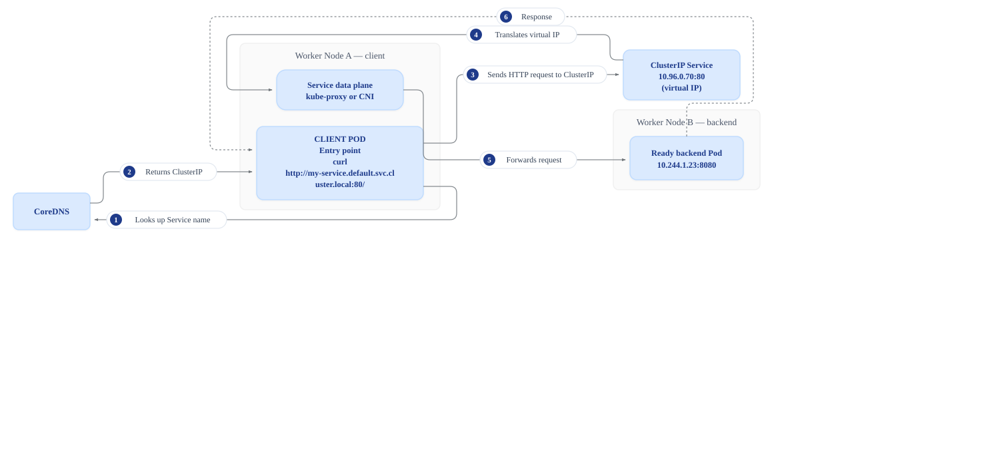

# ClusterIP Service

## Table of Contents

- [What ClusterIP does](#what-clusterip-does)
- [Client-to-Service component diagram](#client-to-service-component-diagram)
- [Understand the Service address and ports](#understand-the-service-address-and-ports)
- [Create, inspect, and call the Service](#create-inspect-and-call-the-service)
- [More Service details](#more-service-details)

This guide describes [`cluster-ip-service.yaml`](cluster-ip-service.yaml), which creates `my-clusterip-service` for Pods labeled `app=my-app`.

## What ClusterIP does

`ClusterIP` is the default Service type. Kubernetes assigns the Service a stable virtual IP that clients inside the cluster can use. The Service's selector identifies matching Pods, and the service data plane forwards each connection to a ready backend endpoint.

The ClusterIP is not a Pod IP and does not identify a server process. By default, clients outside the cluster cannot connect directly to it. Use a NodePort, LoadBalancer, Ingress, or a local port-forward when an external client needs access.

## Client-to-Service component diagram

The **Client Pod** is the entry point. The SVG keeps the DNS lookup/answer, HTTP request, backend forwarding, and response paths separate. CoreDNS resolves the Service name to the ClusterIP; it does not proxy the HTTP request.



Worker Node A and Worker Node B show example placement only; Kubernetes can schedule Pods on any nodes. Service data-plane rules are implemented across worker nodes, but are shown once for readability. The backend Pod IP and example ClusterIP can change, so clients should use the Service name. The response returns over the established connection.

## Understand the Service address and ports

The manifest defines:

| Field | Example | Meaning |
| --- | --- | --- |
| `type` | `ClusterIP` | Creates an in-cluster virtual Service address. This is also the default if `type` is omitted. |
| `clusterIP` | `10.96.0.70` | Example address allocated by Kubernetes for this Service. The manifest lets Kubernetes assign it. |
| `port` | `80` | Service port used by clients, including clients using the Service DNS name. |
| `targetPort` | `80` | Port on the selected Pod to which traffic is forwarded. |
| `selector` | `app: my-app` | Selects Pods with the matching label. |

The address and port mapping is:

```text
Client Pod -> my-clusterip-service:80 -> selected PodIP:80
```

If a client Pod is in the same namespace, it can use the short name:

```text
http://my-clusterip-service:80/
```

From another namespace, use the namespace-qualified name:

```text
http://my-clusterip-service.default:80/
```

The fully qualified DNS name is `my-clusterip-service.default.svc.cluster.local` when the cluster uses the default DNS suffix.

## Create, inspect, and call the Service

Create or update the Service from the manifest:

```shell
kubectl apply -f cluster-ip-service.yaml
```

Representative first-apply output:

```text
service/my-clusterip-service created
```

Inspect the allocated address and Service port:

```shell
kubectl get service my-clusterip-service
kubectl describe service my-clusterip-service
kubectl get endpointslice -l kubernetes.io/service-name=my-clusterip-service
```

Representative `kubectl get service` output:

```text
NAME                  TYPE        CLUSTER-IP     EXTERNAL-IP   PORT(S)   AGE
my-clusterip-service  ClusterIP   10.96.0.70     <none>        80/TCP    2m
```

`<none>` under `EXTERNAL-IP` is expected for a ClusterIP Service. The EndpointSlice should list ready Pod IPs and target ports. If it has no addresses, check the Service selector and Pod readiness.

From a Pod in the same namespace, call the Service by name:

```shell
curl -i http://my-clusterip-service.default.svc.cluster.local:80/
```

The Service chooses one ready endpoint for the connection. It does not guarantee even round-robin behavior across repeated requests.

## More Service details

For Service types, selectors, EndpointSlices, editing, deletion, and NodePort/LoadBalancer access, see the [Kubernetes Service guide](../README.md). For node-address access through a NodePort, see the [NodePort guide](../NodePort/README.md).
