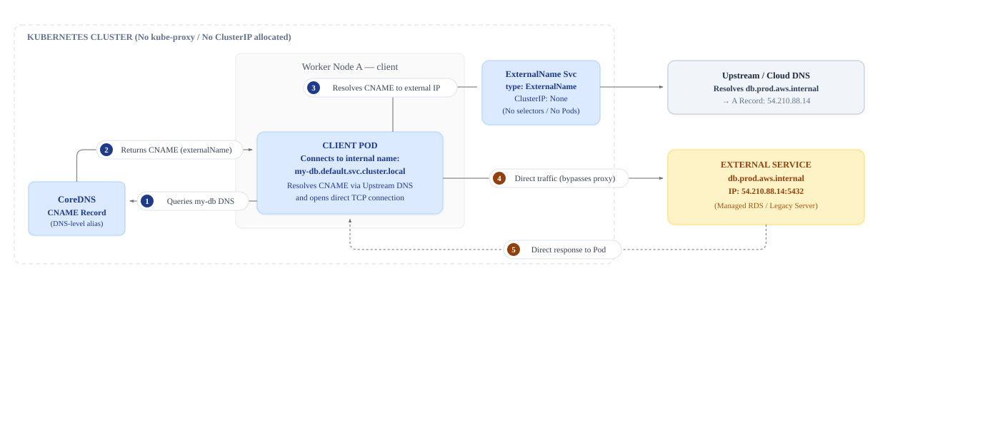

# ExternalName Service

## Table of Contents

- [What ExternalName does](#what-externalname-does)
- [ExternalName DNS alias diagram](#externalname-dns-alias-diagram)
- [Understand the Service name and DNS target](#understand-the-service-name-and-dns-target)
- [Create, inspect, and resolve the Service](#create-inspect-and-resolve-the-service)
- [Limitations and troubleshooting](#limitations-and-troubleshooting)
- [More Service details](#more-service-details)

This guide describes [`external-name-service.yaml`](external-name-service.yaml), which creates `my-external-db` in the `default` namespace and maps its DNS name to `example.com`.

## What ExternalName does

An `ExternalName` Service creates a DNS alias from a Kubernetes Service name to an external DNS hostname. When a client looks up the Service name, cluster DNS returns a CNAME record for the configured `spec.externalName`. The client then resolves that hostname and connects directly to the external destination. The Service does not proxy or forward the network traffic. [Kubernetes Service documentation](https://kubernetes.io/docs/concepts/services-networking/service/#type-externalname)

Unlike `ClusterIP`, `NodePort`, and `LoadBalancer` Services, an `ExternalName` Service does not get a virtual IP, select Pods, create EndpointSlices, or use the Service data plane. It is a DNS alias only.

## ExternalName DNS alias diagram

The Client Pod asks CoreDNS to resolve the Kubernetes Service name. CoreDNS returns a CNAME for `example.com`; the client's DNS resolver follows that name, and the client connects directly to the external service. CoreDNS is not in the HTTP or database traffic path.



The diagram shows the Service-name lookup and direct client connection separately. DNS resolution returns names or addresses; it does not provide a port. The client must use the port required by the external service.

## Understand the Service name and DNS target

The manifest defines:

| Field | Example | Meaning |
| --- | --- | --- |
| `metadata.name` | `my-external-db` | Name clients use inside the cluster. |
| `metadata.namespace` | `default` | Namespace containing the alias. The manifest sets this explicitly. |
| `spec.type` | `ExternalName` | Tells Kubernetes DNS to create a CNAME alias instead of a virtual-IP Service. |
| `spec.externalName` | `example.com` | External DNS hostname returned as the CNAME target. Use a hostname only; do not include a scheme, port, path, or IP address. |

Within the `default` namespace, a client Pod can use the short Service name:

```text
my-external-db
```

From another namespace, use a namespace-qualified name or the fully qualified Service DNS name:

```text
my-external-db.default
my-external-db.default.svc.cluster.local
```

The fully qualified form uses the default cluster DNS suffix `cluster.local`; a cluster can be configured with a different suffix.

The DNS alias does not specify an application port. If the external destination listens on port 5432, the client must use port 5432 in its connection settings. For an HTTP target on port 80, a client could request:

```text
http://my-external-db.default.svc.cluster.local:80/
```

The external target must be a DNS hostname. An IP address in `externalName` is treated as a DNS name, not as an address. If you need to map a Service to fixed IP endpoints, use a different Service pattern such as a headless Service with manually managed EndpointSlices.

## Create, inspect, and resolve the Service

Apply the manifest from the repository root:

```shell
kubectl apply -f k8s/networking/k8s-Service/ExternalName/external-name-service.yaml
```

Typical first-apply output:

```text
service/my-external-db created
```

If the Service already exists, `kubectl apply` reports `configured` when it changes the object or `unchanged` when no change is needed.

Inspect the Service:

```shell
kubectl get service my-external-db
kubectl describe service my-external-db
kubectl get service my-external-db -o yaml
kubectl get endpointslice -l kubernetes.io/service-name=my-external-db
```

Representative `kubectl get service` output:

```text
NAME             TYPE           CLUSTER-IP   EXTERNAL-IP   PORT(S)   AGE
my-external-db   ExternalName   <none>       example.com   <none>    1m
```

`<none>` under `CLUSTER-IP` and `PORT(S)` is expected. Kubernetes is publishing a DNS alias, not allocating a Service IP or port. The `EXTERNAL-IP` column displays the configured DNS target; it is not a load-balancer IP.

The relevant `kubectl describe service` fields look like this:

```text
Name:           my-external-db
Namespace:      default
Selector:       <none>
Type:           ExternalName
External Name:  example.com
Endpoints:      <none>
```

An ExternalName Service has no Pod endpoints. The EndpointSlice query therefore returns no resources:

```text
No resources found in default namespace.
```

Resolve the Service name from an existing Pod that has `nslookup` installed. Replace `<client-pod>` with that Pod's name:

```shell
kubectl exec -it <client-pod> -- nslookup my-external-db.default.svc.cluster.local
```

Representative output includes the CNAME target and the target's DNS answer:

```text
Server:    10.96.0.10
Address:   10.96.0.10:53

my-external-db.default.svc.cluster.local canonical name = example.com
Name:      example.com
Address:   93.184.216.34
```

DNS server addresses and the external hostname's IP addresses vary by cluster and DNS provider. The important check is that the Service name resolves to the configured external hostname.

## Limitations and troubleshooting

- **DNS only:** There is no ClusterIP, NodePort, load balancer, Pod selector, EndpointSlice, or Service proxy for this Service.
- **Target format:** Set `externalName` to a DNS hostname such as `example.com`. Do not use `https://example.com`, `example.com:443`, a URL path, or an IP address.
- **External DNS and connectivity:** CoreDNS and the client must be able to resolve the target, and the client network must be able to reach its returned address and port.
- **HTTP Host and TLS SNI:** A client using the Kubernetes Service name may send that alias as its HTTP `Host` header or TLS server name. The external server may expect the configured target hostname, causing routing or certificate errors. Use an approach that can set the required host name, or choose a proxy/Ingress/Gateway when host rewriting is needed. [Kubernetes documents this ExternalName caveat](https://kubernetes.io/docs/concepts/services-networking/service/#cname-and-your-service).
- **No port-forwarding:** `kubectl port-forward service/my-external-db ...` is not a way to reach this target. ExternalName has no Pod endpoints for the API server to forward to.

If a DNS lookup fails, check the spelling of `externalName`, the Service namespace and DNS name, and whether CoreDNS can resolve external names. If DNS succeeds but the application connection fails, check the external server, protocol, port, network policy, firewall, and hostname expectations.

## More Service details

For Service types and routing components, see the [Kubernetes Service guide](../README.md). Compare the [ClusterIP guide](../ClusterIP/README.md) for in-cluster virtual-IP routing, the [NodePort guide](../NodePort/README.md) for node-address access, and the [LoadBalancer guide](../LoadBalancer/README.md) for provider-managed external addresses.
