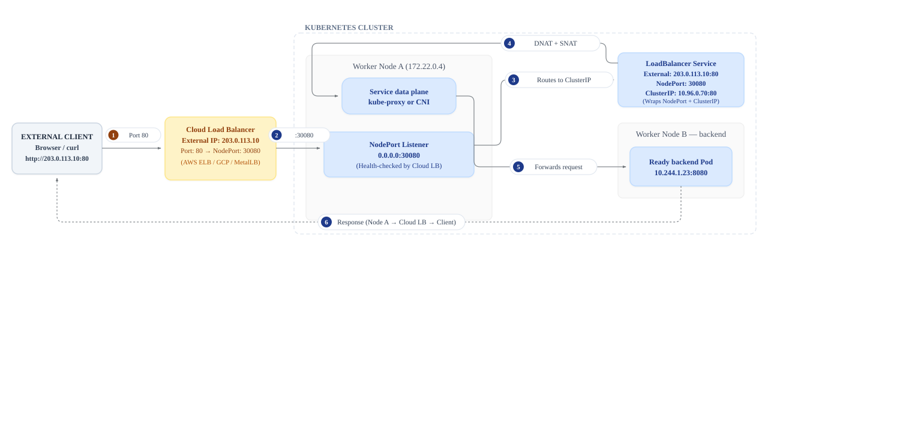

# LoadBalancer Service

## Table of Contents

- [What LoadBalancer does](#what-loadbalancer-does)
- [LoadBalancer component diagram](#loadbalancer-component-diagram)
- [Understand the addresses and ports](#understand-the-addresses-and-ports)
- [Create, inspect, and access the Service](#create-inspect-and-access-the-service)
- [Enable LoadBalancer in Kind](#enable-loadbalancer-in-kind)
- [Troubleshoot pending or unreachable Services](#troubleshoot-pending-or-unreachable-services)
- [More Service details](#more-service-details)

This guide describes [`load-balancer-service.yaml`](load-balancer-service.yaml). It creates the `my-lb-service` Service for Pods labeled `app=my-app`. The manifest does not set a namespace, so kubectl uses the namespace selected by the current context (normally `default`).

## What LoadBalancer does

`type: LoadBalancer` asks the cluster's cloud provider or load-balancer controller to provision an external load balancer for the Service. Kubernetes does not provide that external load balancer by itself. Provisioning happens asynchronously, and the controller publishes its address in `.status.loadBalancer.ingress`. [Kubernetes Service documentation](https://kubernetes.io/docs/concepts/services-networking/service/#loadbalancer)

A LoadBalancer Service also has a ClusterIP. Kubernetes normally allocates a NodePort too; a provider can use that NodePort to reach the Service's ready Pod endpoints. The client uses the external address and Service port, for example `http://172.22.0.5:80/` in the current Kind example. The external address is allocated by the provider and can change.

If the cluster has no working load-balancer implementation, `EXTERNAL-IP` stays `<pending>`. The Service can still have healthy Pod endpoints and an assigned NodePort while the external address is pending.

## LoadBalancer component diagram

The Client calls the external address. For this Kind example, the `cloud-provider-kind` controller watches the Service API object, creates and configures an Envoy load-balancer container, and writes the external IP to Service status. The Envoy proxy then forwards traffic to a node's NodePort; the node's Service data plane selects a ready Pod.



The control/status path (purple dashed arrows) provisions the load balancer; it is not an HTTP hop. The blue arrows show the request path, and the gray dashed arrow shows the response. This example shows the Kind provider's NodePort-based path; other providers can route to endpoints differently.

## Understand the addresses and ports

| Field or address | Example | Meaning |
| --- | --- | --- |
| `type` | `LoadBalancer` | Requests an external load balancer from a provider or controller. |
| `clusterIP` | `10.96.237.170` | Stable virtual Service IP for in-cluster clients. Kubernetes allocates it. |
| Service `port` | `80` | Port clients use on the Service and external load balancer. |
| `targetPort` | `80` | Port on a selected Pod where the application listens. |
| `nodePort` | `30886` | Node port allocated for this Service. The Kind provider uses node ports to forward to the Service in this example. |
| `EXTERNAL-IP` | `172.22.0.5` | Address written to Service status by the load-balancer implementation. It may be `<pending>` until provisioned. |
| `ipMode` | `Proxy` | Indicates the implementation delivers traffic through a proxy. This field appears in the Service status on supported Kubernetes versions. |

Connect to the external load balancer using its IP and the Service port (`80`), not the allocated NodePort (`30886`):

```text
Client -> <EXTERNAL-IP>:80 -> load-balancer proxy -> node:30886 -> ready PodIP:80
```

The NodePort is part of the provider-to-cluster path in this example. Clients do not normally need to use it when calling the LoadBalancer address.

## Create, inspect, and access the Service

Apply the manifest from the repository root:

```shell
kubectl apply -f k8s/networking/k8s-Service/LoadBalancer/load-balancer-service.yaml
```

Typical first-apply output:

```text
service/my-lb-service created
```

If the Service already exists, `kubectl apply` reports `configured` when it changes the object or `unchanged` when no change is needed. This confirms the API object was applied; it does not confirm that an external load balancer is ready.

Inspect the Service and its backend endpoints:

```shell
kubectl get service my-lb-service -o wide
kubectl describe service my-lb-service
kubectl get endpointslice -l kubernetes.io/service-name=my-lb-service
```

Example `kubectl get service` output from the Kind cluster:

```text
NAME            TYPE           CLUSTER-IP      EXTERNAL-IP   PORT(S)        AGE
my-lb-service   LoadBalancer   10.96.237.170   172.22.0.5    80:30886/TCP   20m
```

`80:30886/TCP` means Service port `80` and allocated NodePort `30886`, both using TCP. `EXTERNAL-IP` is the address clients use after the provider assigns it.

The important lines from `kubectl describe service my-lb-service` look like this:

```text
Name:                     my-lb-service
Namespace:                default
Selector:                 app=my-app
Type:                     LoadBalancer
IP:                       10.96.237.170
LoadBalancer Ingress:     172.22.0.5 (Proxy)
Port:                     <unset>  80/TCP
TargetPort:               80/TCP
NodePort:                 <unset>  30886/TCP
Endpoints:                10.244.1.23:80,10.244.2.25:80,10.244.2.26:80
Events:
  Normal  EnsuredLoadBalancer  ...  Ensured load balancer
```

The `Endpoints` line should list ready backend addresses. The `EnsuredLoadBalancer` event means the provider completed reconciliation. The exact IPs, ports, and ages vary by cluster.

Get the external IP and call it from a client that can reach that address:

```shell
kubectl get service my-lb-service -o jsonpath='{.status.loadBalancer.ingress[0].ip}{"\n"}'
curl -i http://172.22.0.5:80/
```

The first command prints the provider-assigned address. Replace `172.22.0.5` with the value from your cluster. An HTTP response such as `200 OK` confirms the client reached the application; the response body depends on the selected Pod.

## Enable LoadBalancer in Kind

Kind does not provide a cloud load balancer by itself. `cloud-provider-kind` runs as a host-side binary, watches Kind Services of type `LoadBalancer`, provisions load-balancer containers, and updates Service status. It must be running; installing the binary alone is not enough. [Kind LoadBalancer guide](https://kind.sigs.k8s.io/docs/user/loadbalancer/) · [cloud-provider-kind instructions](https://github.com/kubernetes-sigs/cloud-provider-kind#running-the-provider)

In WSL, install the binary if needed:

```shell
go install sigs.k8s.io/cloud-provider-kind@latest
```

Run the provider in a WSL terminal and leave it running. With the default Go install location:

```shell
sudo env KUBECONFIG="$HOME/.kube/config" "$HOME/go/bin/cloud-provider-kind"
```

If you configured a custom `GOBIN`, use that directory in place of `$HOME/go/bin`. WSL2 requires `sudo` because the provider needs permission to set up load-balancer IPs and listen on their ports. It should log that it connected to your Kind cluster, started its Service controller, synced caches, and ensured the load balancer. [WSL2 support notes](https://github.com/kubernetes-sigs/cloud-provider-kind#mac-windows-and-wsl2-support)

In another WSL terminal, watch the Service status:

```shell
kubectl get service my-lb-service -w
```

Wait for `EXTERNAL-IP` to change from `<pending>` to an address. In WSL2, the provider documentation recommends using the external IP from WSL. A Windows client may need to use a Docker-published host port; check the `kindccm` container's `PORTS` column with `docker ps --filter name=kindccm`.

`extraPortMappings` is not required to make a LoadBalancer IP get assigned. It maps host ports to Kind node container ports and is used for setups such as NodePort or Ingress. [Kind port-mapping guide](https://kind.sigs.k8s.io/docs/user/configuration/#extra-port-mappings)

## Troubleshoot pending or unreachable Services

### `EXTERNAL-IP` is `<pending>`

Check the Service status and events:

```shell
kubectl get service my-lb-service -o wide
kubectl describe service my-lb-service
```

Then check that `cloud-provider-kind` is still running in WSL and connected to the Kind cluster that contains this Service. Look for logs similar to:

```text
Connected successfully cluster="mcu-multicluster"
Starting service controller
Caches are synced
Ensuring load balancer for service default/my-lb-service
EnsuredLoadBalancer
```

Check the provider's proxy container:

```shell
docker ps --filter name=kindccm
```

If there is no `kindccm` container and the Service stays pending, the provider may not be running, may be using the wrong kubeconfig/context, or may have failed to connect to Docker. EndpointSlices can still contain Pods while the external address is pending; these are separate parts of the Service lifecycle.

### An external IP is assigned, but requests time out

Verify the EndpointSlice and test the allocated NodePort from WSL to distinguish a backend problem from an external address or tunnel problem:

```shell
kubectl get endpointslice -l kubernetes.io/service-name=my-lb-service
curl -i http://172.22.0.2:30886/
```

Replace the example node IP and NodePort with the current values from `kubectl get nodes -o wide` and `kubectl get service my-lb-service`. If NodePort returns the application but the external IP does not, the Service's Pods are reachable and the remaining problem is the load-balancer tunnel or client-to-IP network path. For WSL2, use the provider's [WSL2 networking notes](https://github.com/kubernetes-sigs/cloud-provider-kind#mac-windows-and-wsl2-support) and inspect Docker-published ports with `docker ps --filter name=kindccm`.

## More Service details

For Service types, selectors, EndpointSlices, and updates, see the [Kubernetes Service guide](../README.md). Compare the [ClusterIP guide](../ClusterIP/README.md) for in-cluster access and the [NodePort guide](../NodePort/README.md) for direct node-address access.
