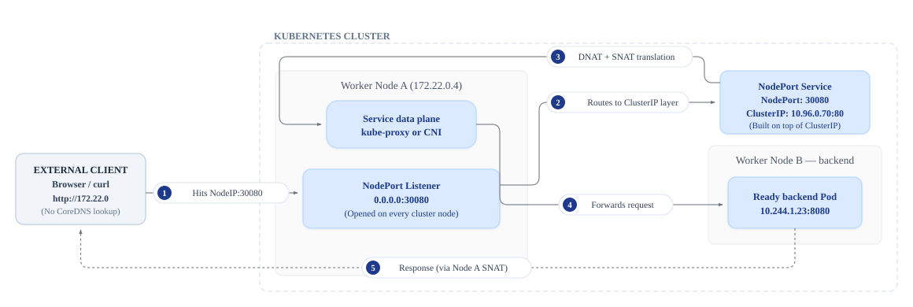

# NodePort Service

## Table of Contents

- [What NodePort does](#what-nodeport-does)
- [NodePort component diagram](#nodeport-component-diagram)
- [Understand the ports](#understand-the-ports)
- [Access a NodePort Service](#access-a-nodeport-service)
- [Detailed WSL and Kind guide](#detailed-wsl-and-kind-guide)

This guide introduces the traffic path for the [`my-nodeport-service`](nodeport-service.yaml) Service. A NodePort exposes the Service on the same port number on every cluster node. A client connects to a reachable node IP and that port; Kubernetes forwards the connection to one of the Service's ready backend Pods.

## What NodePort does

A NodePort Service also has a ClusterIP for in-cluster clients. NodePort adds an entry point on each node for clients outside the cluster:

```text
In-cluster client:  my-nodeport-service:80
External client:    <Node-IP>:30080
Service to Pod:     Service port 80 -> Pod targetPort 80
```

The node IP must be reachable from the client, and firewalls or local-cluster networking must allow the traffic. NodePort does not create a single shared IP, DNS name, or external load balancer.

## NodePort component diagram



Each node is an entry point to the same Service, not a separate copy of the application. With `externalTrafficPolicy: Cluster`, a request entering one node can be forwarded to a ready Pod on another node. The Service data plane selects an endpoint for each connection; it does not guarantee an even round-robin distribution.

## Understand the ports

| Address or field | Example | Meaning |
| --- | --- | --- |
| Node IP | `172.22.0.2` | Address of a node reachable from the client. |
| `nodePort` | `30080` | Port exposed on each node for this Service. If omitted from the manifest, Kubernetes allocates one from the configured NodePort range. |
| Service `port` | `80` | Port used by in-cluster clients and as the Service port for forwarding. |
| Service `targetPort` | `80` | Port on the selected Pod where the application listens. |
| Pod IP and target port | `10.244.2.25:80` | One backend endpoint; Pod IPs can change when Pods are replaced. |

The example `http://172.22.0.2:30080/` enters through the node's NodePort. It is not a request to the Pod IP. The Service rules forward it to a matching ready Pod, using the Pod IP and `targetPort`.

## Access a NodePort Service

First find node IPs and the assigned NodePort:

```shell
kubectl get nodes -o wide
kubectl get service my-nodeport-service
```

If the Service output shows `80:30080/TCP`, make a request to any reachable node IP on port `30080`:

```shell
curl -i http://172.22.0.2:30080/
```

You can also use another reachable node IP with the same NodePort:

```shell
curl -i http://172.22.0.3:30080/
```

Replace the sample addresses with the node IPs from your cluster. If the client cannot reach those node IPs, use a cluster-specific port mapping or `kubectl port-forward` for local development.

## Detailed WSL and Kind guide

For command output, endpoint inspection, tests against each node, port forwarding, and troubleshooting on WSL/Kind, see [Access a Pod through a NodePort Service](access-nodeport.md).
